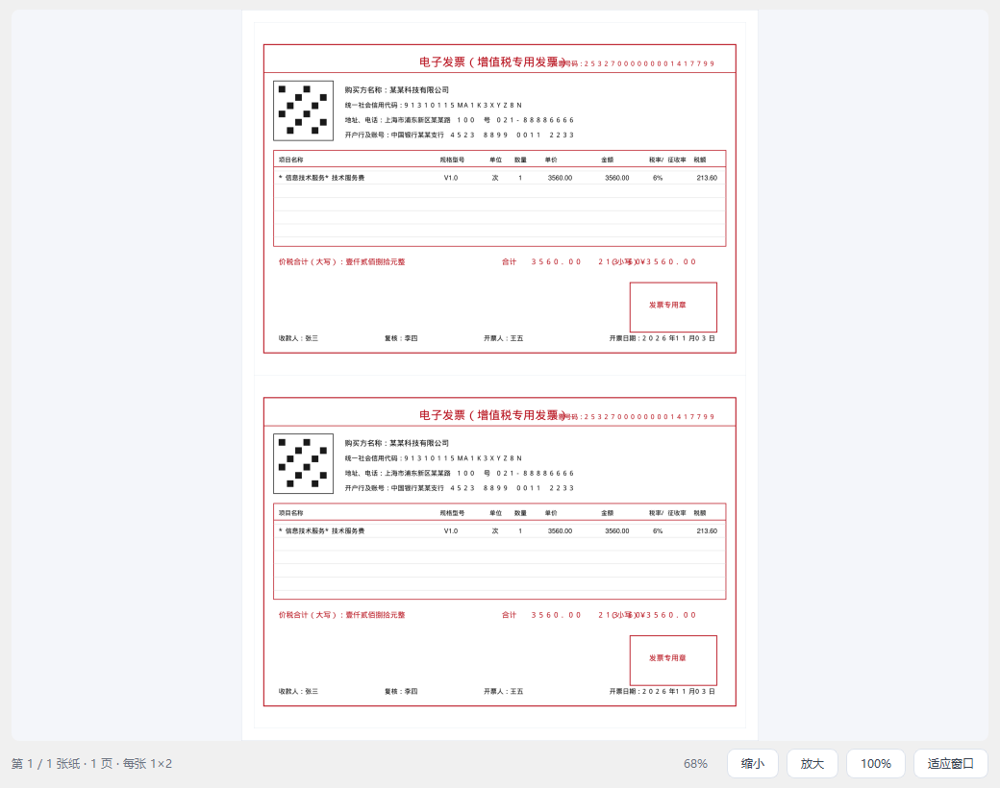
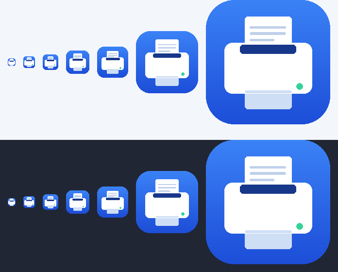

# 发票打印助手 · Invoice Print Assistant

> 把一批 PDF 发票拖进来，每个文件独立成一张发票、独立送打印，按 A4「每张纸上下两张」拼版。
> Windows 桌面程序，PySide6 + PyMuPDF，**不联网、不收集任何数据**。

**English** — A Windows desktop tool that batch-prints PDF invoices: drag in a folder of
invoice PDFs, it imposes two pages per A4 sheet (1×2, portrait) and sends each invoice to the
printer as its own job. Extracts 物料名称 / 规格型号 / 数量 / 单价 / 发票号 from the PDF text
layer into a searchable history with CSV export. Built with PySide6 + PyMuPDF. Fully offline.

*Keywords: pdf invoice printer, batch print pdf, invoice imposition, n-up printing, 2-up A4,
Chinese invoice (增值税发票 / 电子发票) printing, fapiao, PySide6 desktop app, Windows.*


## 它解决什么问题

财务/采购每天要从邮箱、税务平台下一堆 PDF 发票，一张 A4 打一张太浪费纸，手动拼版又麻烦。
这个程序把「拖进来 → 拼版 → 送打印机」缩成一步：

- **一个 PDF = 一张发票**：多个文件各排各的，互不影响，一张失败不影响其它
- **自动 1×2 拼版**：默认 A4 纵向、每张纸上下两页、页边距 0.51cm、缩放 95.5%，和 Word 里手动设的一致
- **矢量输出**：拼好的版面直接生成矢量 PDF 送打印机，每张纸几 KB（位图路线要约 30MB），红章与细线保真
- **清晰度可控**：200 / 300 / 600 dpi 三档，实际渲染不会超过打印机的物理分辨率（设 300 就真的是 300）
- **灰度送印**：黑白激光机按 8 位灰度出图，送进打印队列的数据少约 3/4，出纸更快（彩色机可关掉）
- **拖图标即打印**：把 PDF 直接拖到 exe 图标上，不弹界面，右下角飘一张进度卡，打完自己退出
- **自动记录**：从 PDF 文本层提取 材料名称 / 规格型号 / 数量 / 含税单价 / 发票号，写进历史记录，可导出 CSV
- **只打发票**：合同、报价单这类没有发票字样的 PDF 自动跳过，不出纸（可关）
- **重复提醒**：同一张发票再拖一次会先问一句，避免重复出纸

| 拖图标打印的小卡片 | 拼版预览（点一下放大） |
| --- | --- |
|  |  |

## 下载使用

到 [Releases](https://github.com/shenjx1/invoice-print-assistant/releases) 页面下载 **`invoice-print-assistant-setup.exe`**（单文件安装程序）：

1. 双击安装程序，确认后自动装到 `%LOCALAPPDATA%\Programs\发票打印助手`
2. 桌面和开始菜单会自动出现快捷方式，装完直接启动
3. 把发票 PDF 拖到桌面图标上，开打

**全程不需要管理员权限**（不写 Program Files、不碰 HKLM）。卸载去「设置 → 应用 →
发票打印助手」，或运行安装目录下的 `卸载 发票打印助手.bat`；卸载**不会删除**
`%APPDATA%\InvoicePrintAssistant` 里的配置和历史记录，重装后还在。

> 首次运行只会写 `%APPDATA%\InvoicePrintAssistant`（配置、历史、日志），不碰系统目录、不联网。

如果 Windows 提示「已保护你的电脑」：因为安装包没有买代码签名证书，属于已知情况，
点「更多信息 → 仍要运行」即可。也可以在下载后右键 exe → 属性 → 勾选「解除锁定」。

<details>
<summary>老版本：zip 包安装方式（仍可用）</summary>

下载 `invoice-print-assistant-v1.1.0.zip`（45 MB，解压后 105 MB），完整解压 →
双击 `安装到本机.bat` → 拖 PDF 到桌面图标。程序是**文件夹版**（exe 旁边有 `_internal`），
不能只拷 exe。
</details>

## 从源码运行

```bash
python -m pip install -r requirements.txt
python main.py
```

需要 Python 3.11+（开发环境是 3.13）。

## 自己打包

```bash
build.bat            # 装依赖 → 生成图标 → PyInstaller 文件夹版
```

产物在 `dist\发票打印助手\`。再打安装程序：

```bash
python installer\build_setup.py            # 用现有 dist 产物
python installer\build_setup.py --rebuild  # 先重新打包应用，再建安装程序
```

产物 `dist_installer\发票打印助手_安装程序.exe`。它会校验 `installer/setup_main.py`
里的程序名与 `app/config.py` 一致 —— 改名后忘了同步会直接构建失败，而不是装出个名字对不上的东西。

自检安装包（只解包到临时目录，不写快捷方式、不动注册表）：

```bash
dist_installer\发票打印助手_安装程序.exe --dry-run --target %TEMP%\ipa_selftest
```

打 tag 推上去也能自动出 Release：

```bash
git tag v1.2.0
git push origin v1.2.0
```

自动构建脚本在 [`docs/ci/build.yml`](docs/ci/build.yml)：在 Windows runner 上装依赖、生成图标、打包、把 zip 挂到 Release。
它没有放在 `.github/workflows/` 里，是因为创建仓库时用的令牌不含 `workflow` 权限（GitHub 会拒绝推送这个目录）。

想启用：在网页上打开 `docs/ci/build.yml` → 复制全部内容 → **Actions** 标签页 → *New workflow* → 粘贴、命名 `build.yml` 提交即可。

## 改名字 / 换图标

名字集中在 `app/config.py` 顶部两行：

```python
PROGRAM_NAME = "发票打印助手"   # exe 文件名、任务栏、右键菜单、「打开方式」
UI_NAME = "发票打印助手"        # 窗口标题、卡片标题、弹窗标题
```

图标由 `tools/make_icon.py` 用 Pillow **程序化画出**（蓝色圆角底 + 白色打印机 + 进纸口露出的发票页），
16/24/32 px 各画一遍，小尺寸另加放大处理，所以在标题栏里也认得出是一台打印机：



改完跑 `python tools\make_icon.py` 重新生成 `assets/icon.ico` 与预览图。

## 实现要点

```
main.py                 入口：单实例命名管道、拖放/右键启动、无界面小卡片
app/config.py           程序名、数据目录、设置读写（含损坏字段逐项兜底）
app/ui.py               主界面：拖放区、参数面板、拼版预览、历史记录、设置弹窗
app/mini.py             右下角小进度卡
app/engine.py           拼版引擎（1×1 / 1×2 / 2×2 …，边距、缩放、自动旋转）+ 打印分发
app/pdfout.py           矢量拼版：把页面合成到 A4，全程不栅格化
app/printers.py         打印引擎探测：SumatraPDF（矢量）/ GDI（位图）
app/gdi.py              PDF → 位图（PyMuPDF 渲染，默认 300 DPI）+ GDI 绘制
app/extract.py          文本层解析：发票号、材料名称、规格型号、数量、单价；非发票识别
app/invoice.py          单个 PDF 的状态机
app/worker.py           常驻打印线程，一张一条打印作业
app/history.py          历史记录（JSON，最多 500 条）
app/shellmenu.py        右键菜单 / 「打开方式」，只写 HKCU，不需要管理员
app/style.py            QSS 主题
installer/              安装程序（一个 exe 双击即装，免管理员）
tools/                  图标生成、打包、安装包构建、开发自测脚本
```

几个刻意的取舍：

- **靠 PyMuPDF 取文字层，不做 OCR**：发票 PDF 都是电子版，文字层可靠；扫描件识别不了金额但不拦着打印
- **一张发票一条打印作业**：不用一个大文件拼完再打，某张卡纸/缺纸时只影响那一张
- **单实例 + 命名管道**：已开着界面时再拖文件，会把文件转给已有进程，不会两个进程抢打印队列
- **文件夹版而不是单文件 exe**：单文件每次启动要先解包 180 MB，冷启动 8~11 秒；文件夹版 1~2 秒

## 打印引擎：矢量还是位图

打印走哪条路线是**设置面板里的「打印引擎」**，也可以在 `config.json` 里改：

| 引擎 | 送进打印队列的数据 | 依赖 | 说明 |
|---|---|---|---|
| `auto`（默认） | 有 SumatraPDF 就几 KB，否则约 30MB/张 | 无需配置 | 探测到 SumatraPDF 自动走矢量，找不到安静退回位图 |
| `sumatrapdf` | 约几 KB/张 | SumatraPDF.exe | 强制矢量，找不到引擎直接报错，不静默降级 |
| `raster` | 约 25MB/张（A4@300dpi） | 无 | 兼容模式，老打印机、奇怪驱动兜底用 |

**启用矢量打印**：把 [SumatraPDF](https://www.sumatrapdfreader.org/)（约 6MB，便携版即可）的
`SumatraPDF.exe` 放到程序目录，重开程序就会自动识别。也可以放到 PATH 里，或者用环境变量
`INVOICE_PRINT_SUMATRA` 指定完整路径。程序目录里任何 `SumatraPDF*.exe` 都能被认出来。

为什么需要外部引擎：Windows 没有可脚本化的「静默打印 PDF」接口 —— 资源管理器里的「打印」
动词会弹阅读器的对话框。SumatraPDF 提供 `-print-to <打印机> -silent -exit-when-done`，
是这条路线上最小、最稳的方案。

位图路线没有消失：`--print-to-pdf` 之类的调试出口、以及没装 SumatraPDF 的机器，
仍然走 GDI 直打，行为与之前完全一致。

## 自测

`tools/` 下的脚本可以直接跑，覆盖解析、拼版、拖放、单实例、历史记录、右键菜单：

```bash
python tools\test_extract.py
python tools\test_flow.py
python tools\test_only_invoice.py
python tools\test_fixes.py
python tools\test_shell.py
python tools\test_vector.py     # 矢量拼版：文字可提取、体积、A4 尺寸
python tools\test_engine.py     # 打印引擎分发：选路、临时文件清理（不打真纸）
python tools\render_ui.py       # 渲染界面截图到 build_test/
```

## 已知限制

- 只支持 Windows（打印走 Win32 API，右键菜单走注册表）
- **只吃 PDF，不吃 OFD**：国标版式文件（.ofd）需要先转成 PDF；税务平台下载时优先选 PDF 格式
- 扫描版 PDF（图片、无文字层）能正常打印，但提取不到发票号/金额，历史记录里对应字段为空
- 版式按常见电子发票（21×14cm 横版）调过，别的尺寸票据可能要调「缩放比例」

## License

[MIT](LICENSE)
