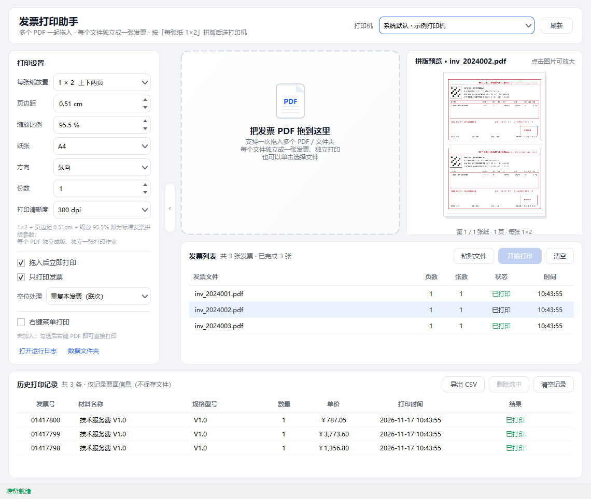

# 发票打印助手

> 把一批 PDF 发票拖进来，每个文件独立成一张发票、独立送打印，按 A4「每张纸上下两张」拼版。
> Windows 桌面程序，PySide6 + PyMuPDF，**不联网、不收集任何数据**。



## 它解决什么问题

财务/采购每天要从邮箱、税务平台下一堆 PDF 发票，一张 A4 打一张太浪费纸，手动拼版又麻烦。
这个程序把「拖进来 → 拼版 → 送打印机」缩成一步：

- **一个 PDF = 一张发票**：多个文件各排各的，互不影响，一张失败不影响其它
- **自动 1×2 拼版**：默认 A4 纵向、每张纸上下两页、页边距 0.51cm、缩放 95.5%，和 Word 里手动设的一致
- **拖图标即打印**：把 PDF 直接拖到 exe 图标上，不弹界面，右下角飘一张进度卡，打完自己退出
- **自动记录**：从 PDF 文本层提取 材料名称 / 规格型号 / 数量 / 含税单价 / 发票号，写进历史记录，可导出 CSV
- **只打发票**：合同、报价单这类没有发票字样的 PDF 自动跳过，不出纸（可关）
- **重复提醒**：同一张发票再拖一次会先问一句，避免重复出纸

| 拖图标打印的小卡片 | 拼版预览（点一下放大） |
| --- | --- |
|  |  |

## 下载使用

到 Releases 页面下载 `发票打印助手.zip`：

1. 完整解压（别在压缩包里直接双击）
2. 双击 `安装到本机.bat` —— 复制到 `D:\发票打印助手\`，建桌面快捷方式，登记右键菜单
3. 把发票 PDF 拖到桌面图标上，开打

> 程序是**文件夹版**（exe 旁边有 `_internal`），不能只拷 exe。
> 首次运行只会写 `%APPDATA%\InvoicePrintAssistant`（配置、历史、日志），不碰系统目录、不联网。

如果 Windows 提示「已保护你的电脑」，双击压缩包里的 `解除锁定.bat`，或右键压缩包 → 属性 → 勾选「解除锁定」。

## 从源码运行

```bash
python -m pip install -r requirements.txt
python main.py
```

需要 Python 3.11+（开发环境是 3.13）。

## 自己打包

```bash
build.bat            # 装依赖 → 生成图标 → PyInstaller 文件夹版
```

产物在 `dist\发票打印助手\`。再跑 `python tools\make_package_onedir.py` 打成可直接发给别人的 zip。

打 tag 推上去也会自动出 Release：

```bash
git tag v1.0.0
git push origin v1.0.0
```

`.github/workflows/build.yml` 会在 Windows runner 上构建并把 zip 挂到 Release。

## 改名字 / 换图标

名字集中在 `app/config.py` 顶部两行：

```python
PROGRAM_NAME = "发票打印助手"   # exe 文件名、任务栏、右键菜单、「打开方式」
UI_NAME = "发票打印助手"        # 窗口标题、卡片标题、弹窗标题
```

图标由 `tools/make_icon.py` 用 Pillow **程序化画出**（蓝色圆角底 + 白色打印机 + 进纸口露出的发票页），
16/24/32 px 各画一遍，小尺寸另加放大处理，所以在标题栏里也认得出是一台打印机：


改完跑 `python tools\make_icon.py` 重新生成 `assets/icon.ico` 与预览图。

## 实现要点

```
main.py                 入口：单实例命名管道、拖放/右键启动、无界面小卡片
app/config.py           程序名、数据目录、设置读写（含损坏字段逐项兜底）
app/ui.py               主界面：拖放区、参数面板、拼版预览、历史记录、设置弹窗
app/mini.py             右下角小进度卡
app/engine.py           拼版引擎（1×1 / 1×2 / 2×2 …，边距、缩放、自动旋转）+ Win32 打印
app/gdi.py              PDF → 位图（PyMuPDF 渲染，默认 300 DPI）
app/extract.py          文本层解析：发票号、材料名称、规格型号、数量、单价；非发票识别
app/invoice.py          单个 PDF 的状态机
app/worker.py           常驻打印线程，一张一条打印作业
app/history.py          历史记录（JSON，最多 500 条）
app/shellmenu.py        右键菜单 / 「打开方式」，只写 HKCU，不需要管理员
app/style.py            QSS 主题
tools/                  图标生成、打包、开发自测脚本
```

几个刻意的取舍：

- **靠 PyMuPDF 取文字层，不做 OCR**：发票 PDF 都是电子版，文字层可靠；扫描件识别不了金额但不拦着打印
- **一张发票一条打印作业**：不用一个大文件拼完再打，某张卡纸/缺纸时只影响那一张
- **单实例 + 命名管道**：已开着界面时再拖文件，会把文件转给已有进程，不会两个进程抢打印队列
- **文件夹版而不是单文件 exe**：单文件每次启动要先解包 180 MB，冷启动 8~11 秒；文件夹版 1~2 秒

## 自测

`tools/` 下的脚本可以直接跑，覆盖解析、拼版、拖放、单实例、历史记录、右键菜单：

```bash
python tools\test_extract.py
python tools\test_flow.py
python tools\test_only_invoice.py
python tools\test_fixes.py
python tools\test_shell.py
python tools\render_ui.py      # 渲染界面截图到 build_test/
```

## 已知限制

- 只支持 Windows（打印走 Win32 API，右键菜单走注册表）
- 扫描版 PDF（图片、无文字层）能正常打印，但提取不到发票号/金额，历史记录里对应字段为空
- 版式按常见电子发票（21×14cm 横版）调过，别的尺寸票据可能要调「缩放比例」

## License

[MIT](LICENSE)
